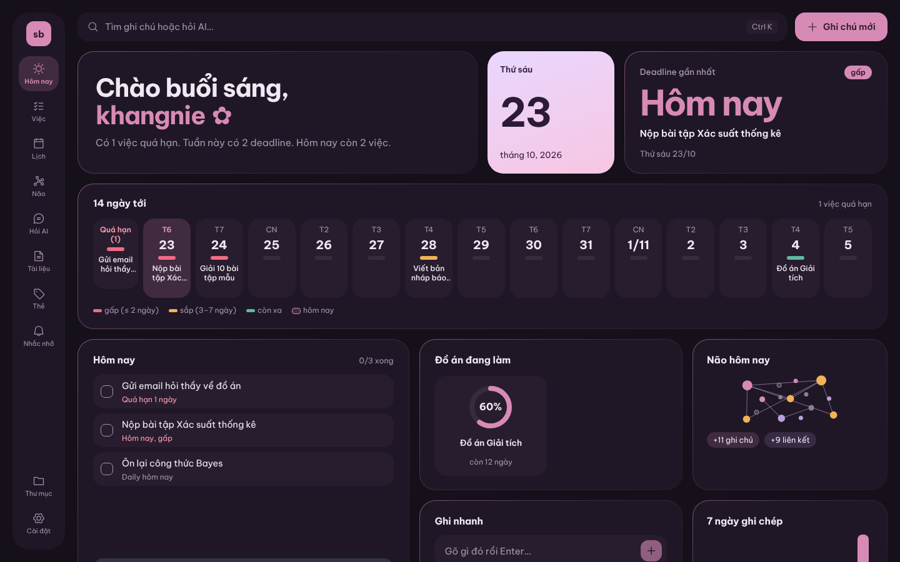
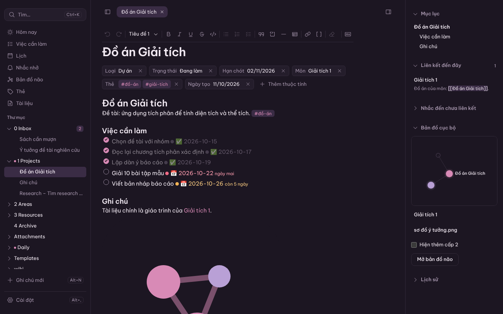
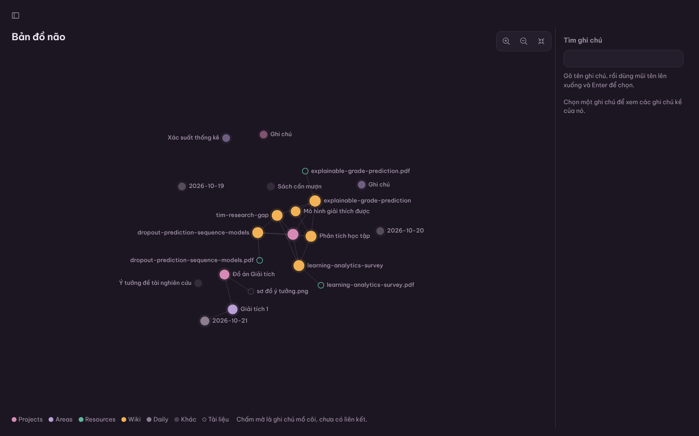
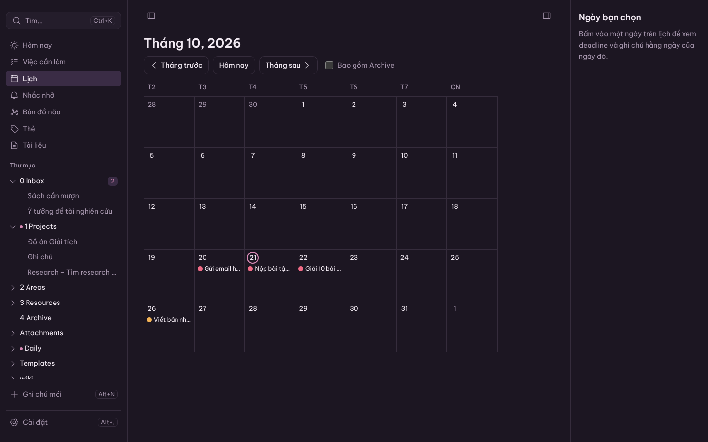
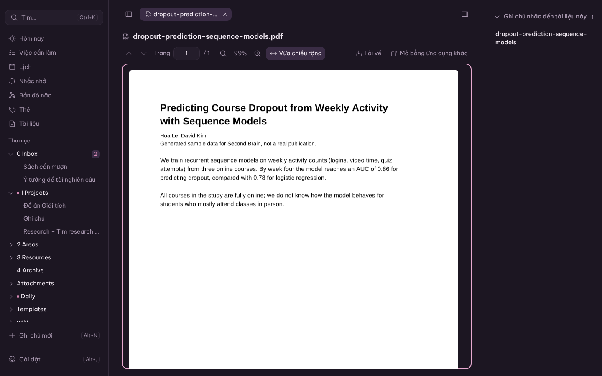
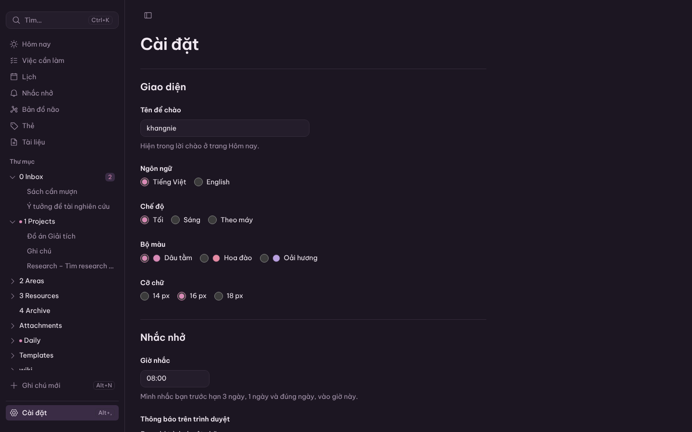
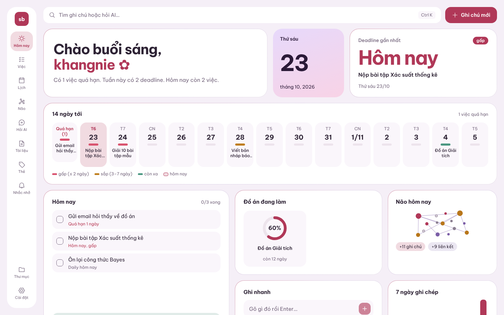
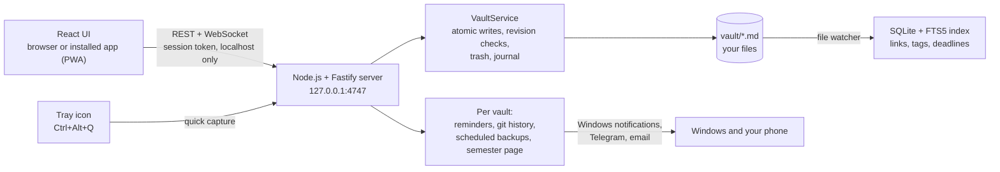

<div align="center">


# Second Brain

**A second brain for students: Markdown notes, deadlines, a calendar and a map of what you know. It all runs on your own computer.**

[Tiếng Việt](README.md) | **English**




</div>

## Why Second Brain

Notion is slow and needs a connection. Obsidian is powerful, but deadlines, a calendar or AI need plugins and setup first. Second Brain feels finished the first time you open it: you see what is due today, you write without friction, and every note stays a plain Markdown file in your own folder.

- **Never miss a deadline.** Deadlines are on the start screen, and the server reminds you with Windows notifications even when the app window is closed, and on Telegram or by email if you turn that on.
- **Capture fast, sort later.** Every routine action takes one or two steps. `Ctrl+Alt+Q` captures a note even while you are in another program.
- **Knowledge that connects.** Two-way links, documents attached to notes, and a brain map of the whole.
- **Your data stays yours.** Everything is `.md` files in one folder. Remove the app and your notes still work. The app never silently changes what you wrote.

The interface is in Vietnamese by default and fully available in English.

## Features

| | |
|---|---|
| **Two styles** | **Soft bento** ("Bento mềm", the default): the Today screen is a grid of soft rounded pastel tiles, each with one job (greeting, date, nearest deadline with the days left, the 14-day strip, today's tasks, project progress rings, today's brain, quick capture, 7 days of writing), with a compact navigation rail on the left and a folders pane. **Calm** ("Yên tĩnh"): the previous, quieter layout. Switch in **Settings → Appearance → Style**; it applies at once. |
| **Writing** | An editor that looks finished as you type, like Notion but without draggable blocks. `## `, `**`, `- [ ]` and `[[` become formatting. There is a `/` menu, a formatting toolbar with Word-style shortcuts (`Ctrl+B/I/U`) and a raw Markdown mode (`Alt+S`). Anything you did not edit is written back byte for byte, including math, HTML and footnotes. |
| **Links** | `[[Wikilinks]]` with accent-insensitive suggestions (`giai tich` finds *Giải tích 1*). Backlinks, unlinked mentions, nested tags (`#course/calculus`) and note properties. Renaming or moving a note updates every link, with undo. |
| **Deadlines and tasks** | The **Today** screen has a 14-day strip colored by urgency, today's tasks and active projects with their progress. There is a **Tasks** view and a monthly **Calendar** where you drag items to reschedule them, with a 10-second undo. |
| **Reminders** | Reminders 3 days before, 1 day before and on the due day, at the time you choose. Windows notifications show even when the app window is closed. Missed reminders are caught up once after sleep and are never repeated. Turn on **Telegram** or **email** (for example Gmail) to get them on your phone; each reminder is sent once, and nothing is sent for an item that is done or moved. |
| **Documents** | Drop or paste PDFs, images and slides into a note; file names are always unique. Images show inside the note. PDFs open in the app with paging, zoom and text selection. The **Documents** view shows which notes mention each file. |
| **Brain map** | Every note is a glowing dot, colored by folder. Click a dot and a signal travels to its neighbours; a search panel makes it fully usable by keyboard. Every note has its own local map. A **timeline** shows your brain growing week by week ("Phát" plays it), **filters** by folder, tag and time dim the rest, and notes edited in the last 24 hours pulse gently. The "Não hôm nay" tile on Today shows what you wrote and linked today. |
| **Semester and weekly review** | Turn on the **"Học kỳ này" page** (This semester) in Settings for a page that keeps itself up to date with your courses and their projects, with deadlines, days left and progress. The app never overwrites your own edits. Every **Sunday**, Today shows a **weekly review**: what is left in the Inbox (with "Dọn Inbox"), what you wrote and finished this week, and next week's deadlines. |
| **Search and capture** | `Ctrl+K` searches all notes without needing accents (including *đ*), filters with `tag:`, `folder:`, `due:7d`, and runs commands after `>`. `Alt+Q` captures to the Inbox; `Alt+T` opens today's daily note. `Ctrl+Alt+Q` opens a small capture box from any program. |
| **AI (M6)** | **Ask AI** about your own notes: deadline questions use exactly Today's list, other questions are answered from a few related note excerpts with links back to the notes. Select text and press `Alt+A` to summarize, rewrite, explain, or get link and tag suggestions. AI suggests where an Inbox note belongs. Search by meaning, and text inside PDFs is searchable. Uses your own API key (Anthropic, OpenAI or Gemini); nothing is sent before you agree, with a monthly token limit. **Connect Claude Desktop through MCP** so Claude turns papers into a research wiki, with permissions enforced by the app; the brain map lights up the pages the AI just updated. |
| **Data safety** | Atomic writes. Every write checks the file's revision, so a file changed elsewhere opens a three-version conflict screen (original, on disk, yours). A trash folder, an operation journal that recovers after a crash, and drafts that keep your words if a tab is killed. **Version history** with git and **zip backups**. **Automatic daily backups** (21:00 by default, to a folder you choose, a USB drive included); if the computer was off at that time, the app catches up when it starts again; it only ever deletes old backups it made itself. The history can also be pushed to a private GitHub repository. |
| **Look and feel** | Dark by default ("Đêm tím"), with a light mode, three palettes, three font sizes and Vietnamese or English, all applied instantly. It installs as an app with its own window and icon, and opens even when you are offline. Narrow, phone-sized windows work too: a tab bar at the bottom and panels that slide up from below. |
| **The .exe** | One file, `Second Brain.exe`, to double-click; running it needs no Node.js. It adds a **tray icon** (open, quick capture, quit), the `Ctrl+Alt+Q` hotkey, Desktop and Start-menu shortcuts, and it can start when you sign in to Windows. |

<table>
  <tr>
    <td></td>
    <td></td>
  </tr>
  <tr>
    <td></td>
    <td></td>
  </tr>
  <tr>
    <td></td>
    <td></td>
  </tr>
</table>

## Installation

### Requirements

| | |
|---|---|
| Operating system | Windows 10 or 11 |
| [Node.js 24 LTS](https://nodejs.org) | Installed once. The app needs 22.12 or later. The `.exe` runs without Node.js, but Node.js is needed to make it. |
| Chrome or Edge | To use and install the app (PWA). |
| [Git for Windows](https://git-scm.com/download/win) | Optional, needed for version history. Without Git the app works the same. |

### Three steps

1. **Get the code** into a folder named `app`:
   ```powershell
   git clone https://github.com/khangnk144/SECONDBRAIN.git D:\SECONDBRAIN\app
   ```
   The parent folder (`D:\SECONDBRAIN` here) holds your notes (`vault\`) and settings (`.secondbrain\`).
2. **Open the app:** double-click `D:\SECONDBRAIN\app\launcher\Mở Second Brain.cmd`. The first start installs libraries and builds the app, which takes a few minutes. The app then opens at `http://localhost:4747`.
   For a shortcut at the top folder, copy `app\launcher\root-wrapper.cmd` to `D:\SECONDBRAIN` and rename it `Mở Second Brain.cmd`.
3. **Install it as an app** (optional): open **Settings → App → Install app**. Turn on **Run when I sign in to Windows** so the app is ready whenever you start your computer.

On first start the app offers **sample data** to try things out. You can remove it at any time in Settings.

### Running it as one .exe (optional)

1. Double-click `D:\SECONDBRAIN\app\launcher\Tạo bản exe.cmd` ("make the exe"). Wait a few minutes until the window says `Xong: "D:\SECONDBRAIN\Second Brain.exe"`.
2. Double-click `D:\SECONDBRAIN\Second Brain.exe`. The file is not signed, so the first time Windows may say "Windows protected your PC": click **More info**, then **Run anyway**.
3. The app opens in the browser as usual, with the same notes and settings. On the first start it adds "Second Brain" shortcuts to the Desktop and the Start menu, and an icon appears in the system tray (the right end of the taskbar).

The exe uses the same `D:\SECONDBRAIN` folder as the launcher, so start the app one way at a time. After updating the code or Node.js, double-click `Tạo bản exe.cmd` again.

### Stopping and updating

- Stop the app: **Settings → Quit Second Brain**, right-click the tray icon → **Quit Second Brain**, or run `"Mở Second Brain.cmd" stop` (the exe: `"Second Brain.exe" --stop`).
- Update: run `git pull` in the `app` folder and start it again. The launcher reinstalls and rebuilds when needed. If you use the exe, make it again after updating.

## Keyboard shortcuts

| Keys | Action | Keys | Action |
|---|---|---|---|
| `Ctrl+K` | Search notes and commands (`>`) | `Alt+G` | Brain map |
| `Alt+N` | New note (pick a template) | `Alt+S` | Raw Markdown mode |
| `Alt+Q` | Quick capture to the Inbox | `Alt+1` / `Alt+2` | Hide or show the left and right panes |
| `Alt+T` | Today's daily note | `Alt+W`, `Alt+[`, `Alt+]` | Close tab, previous tab, next tab |
| `Alt+,` | Settings | `Ctrl+/` | Every shortcut |
| `Ctrl+Alt+Q` | Quick capture from any program (while the tray icon is on) | | |

In Soft bento, `Alt+1` hides or shows the folders pane. Every action also has a button or menu, and every screen works by keyboard alone.

## Where your data lives

```
D:\SECONDBRAIN\
├── vault\                 Your notes: plain Markdown files
│   ├── 0 Inbox\           quick captures, not sorted yet
│   ├── 1 Projects\        course and research projects (with deadlines)
│   ├── 2 Areas\           courses and long-term areas
│   ├── 3 Resources\       source documents: papers\, slides\, web\, other\
│   ├── 4 Archive\         finished (not counted in tasks)
│   ├── Daily\  Templates\  Attachments\  wiki\
│   └── .secondbrain\      the app's state for this vault (index, reminders, trash, journal)
├── Backups\               automatic backups (when turned on, with the default folder)
├── .secondbrain\          machine settings: settings.json (never share this file)
├── Second Brain.exe       the single executable (once you made it)
└── app\                   source code (this repository)
```

- Notes use familiar syntax: `[[links]]`, `#tags`, YAML front matter, tasks like `- [ ] … 📅 2026-11-05` (compatible with Obsidian's Tasks plugin). Open them in Obsidian, VS Code or Notepad.
- The app reads and writes only inside `vault\`. Deleting means moving to the trash (`.secondbrain\trash`, kept 30 days). Multi-file operations are journaled so they can be finished or undone after a crash.
- **Privacy:** the server listens on `127.0.0.1` only, and every request needs the session token and the right origin. Nothing leaves your computer unless you turn on AI, Telegram or email reminders, or the GitHub push; each says what it sends and where before you turn it on. The bot token, the email password and the GitHub token live only in `settings.json`; the app shows just their last four characters and never writes them to logs or backups.

## Architecture



| Part | Technology |
|---|---|
| Server | Node.js 24, TypeScript, Fastify, better-sqlite3 (FTS5), chokidar |
| Interface | React 18, Vite, Tiptap/ProseMirror, zustand, d3-force (canvas), pdf.js, i18next |
| Markdown | unified/remark with a converter that keeps every unedited block as it was |
| Quality | Vitest, Testing Library, Playwright, ESLint (with rules against hard-coded UI text and colors), color contrast checks |

## Development

```bash
npm install
npm run dev          # http://localhost:4747, reloads on change
npm test             # unit and integration tests (server, web, tooling)
npm run test:e2e     # build, then Playwright against a temporary vault
npm run lint         # ESLint, raw colors, VI/EN translation parity, contrast
npm run typecheck
npm run gen-vault -- --out <empty folder>   # a 5,000-note vault for performance tests
npm run build:exe    # makes dist-exe/Second Brain.exe (one runnable file, no Node.js needed)
```

| Folder | Contents |
|---|---|
| `server/` | REST and WebSocket API, vault, index, reminders (Telegram and email included), git history, scheduled backups, the semester page, the weekly review, exe mode and the tray icon |
| `web/` | the interface: editor, screens, the Soft bento and Calm styles, PWA |
| `launcher/` | the Windows launcher (`start`, `stop`, `login`), `Tạo bản exe.cmd`, the tray script |
| `scripts/`, `eslint-rules/` | quality tooling |
| `docs/` | architecture, code standards, deployment guide, changelog |
| `DECISIONS.md`, `MILESTONE-*.md` | design decisions and the acceptance report of each milestone |

A milestone counts as done only when every acceptance criterion has a test, or a manual check recorded in `MILESTONE-<n>.md`. Each milestone is also reviewed by two independent reviewers, one for data safety and one for the interface. The app now has nearly 5,000 automated tests and more than 100 scenarios that run in a real browser.

## Roadmap

| Milestone | Scope | Status |
|---|---|---|
| M0 to M3 | Scaffold, vault and index, editor and links, Today, calendar, search, brain map | ✅ |
| M4 | Windows reminders, Settings, documents and the PDF viewer, version history, backups, installable app (PWA) | ✅ version 1.0 |
| M6 | AI: chat with your own notes with citations, search by meaning, link and tag suggestions, help sorting the Inbox (the AI proposes, you accept); connect Claude through MCP to turn papers into a research wiki; text from PDFs | ✅ |
| M5 | The Soft bento style (the new default); brain map timeline and filters, today's brain; the semester page; weekly review; scheduled backups and GitHub push; narrow-window layout; a `.exe` that needs no Node.js, with a tray icon and `Ctrl+Alt+Q`; Telegram and email reminders | ✅ (owner checks on Windows pending) |

## Troubleshooting

| Problem | What to do |
|---|---|
| "Chưa tìm thấy Node.js" (Node.js not found) | Install Node.js 24 LTS and start the launcher again. |
| Port 4747 is in use | The dialog names the program holding the port. Close it, or change the port in Settings and reinstall the app. |
| The installed app says it cannot reach the server | Double-click the launcher. The app reconnects by itself, with no reload. |
| Version history says it needs Git | Install Git for Windows. Nothing else is affected. |
| Opening `Second Brain.exe` shows "Windows protected your PC" | Click **More info**, then **Run anyway**. The file is not signed, so Windows warns. |
| `Ctrl+Alt+Q` does not open the capture box | Look in **Settings → App**: if another program holds the key, the app says so, and the tray icon's **Quick capture** still works. No tray icon: turn "Tray icon and system-wide shortcut" off and on again. |
| The automatic backup says the folder is missing | Usually a USB drive that is not plugged in. Plug it in and the app retries every hour, or choose another folder. |

The logs (they never contain note text) open from **Settings → Open the log folder**. More in [`docs/deployment-guide.md`](docs/deployment-guide.md).

## License

Copyright © 2026 khangnie. The source code is not released under an open-source license; all rights reserved.

The app uses open-source libraries, each under its own license. They include the [Be Vietnam Pro](https://github.com/bettergui/BeVietnamPro) and [JetBrains Mono](https://github.com/JetBrains/JetBrainsMono) fonts (SIL OFL 1.1), [Phosphor Icons](https://phosphoricons.com) (MIT), [pdf.js](https://github.com/mozilla/pdf.js) (Apache 2.0), [Tiptap](https://tiptap.dev) (MIT), [Fastify](https://fastify.dev) (MIT) and [SQLite](https://sqlite.org) (public domain).
