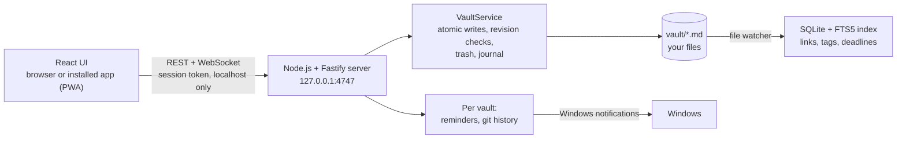

<div align="center">


# Second Brain

**A second brain for students: Markdown notes, deadlines, a calendar and a map of what you know. It all runs on your own computer.**

[Tiếng Việt](README.md) | **English**


</div>

## Why Second Brain

Notion is slow and needs a connection. Obsidian is powerful, but deadlines, a calendar or AI need plugins and setup first. Second Brain feels finished the first time you open it: you see what is due today, you write without friction, and every note stays a plain Markdown file in your own folder.

- **Never miss a deadline.** Deadlines are on the start screen, and the server reminds you with Windows notifications even when the app window is closed.
- **Capture fast, sort later.** Every routine action takes one or two steps.
- **Knowledge that connects.** Two-way links, documents attached to notes, and a brain map of the whole.
- **Your data stays yours.** Everything is `.md` files in one folder. Remove the app and your notes still work. The app never silently changes what you wrote.

The interface is in Vietnamese by default and fully available in English.

## Features (version 1.0)

| | |
|---|---|
| **Writing** | An editor that looks finished as you type, like Notion but without draggable blocks. `## `, `**`, `- [ ]` and `[[` become formatting. There is a `/` menu, a formatting toolbar with Word-style shortcuts (`Ctrl+B/I/U`) and a raw Markdown mode (`Alt+S`). Anything you did not edit is written back byte for byte, including math, HTML and footnotes. |
| **Links** | `[[Wikilinks]]` with accent-insensitive suggestions (`giai tich` finds *Giải tích 1*). Backlinks, unlinked mentions, nested tags (`#course/calculus`) and note properties. Renaming or moving a note updates every link, with undo. |
| **Deadlines and tasks** | The **Today** screen has a 14-day strip colored by urgency, today's tasks and active projects with their progress. There is a **Tasks** view and a monthly **Calendar** where you drag items to reschedule them, with a 10-second undo. |
| **Reminders** | Reminders 3 days before, 1 day before and on the due day, at the time you choose. Windows notifications show even when the app window is closed. Missed reminders are caught up once after sleep and are never repeated. |
| **Documents** | Drop or paste PDFs, images and slides into a note; file names are always unique. Images show inside the note. PDFs open in the app with paging, zoom and text selection. The **Documents** view shows which notes mention each file. |
| **Brain map** | Every note is a glowing dot, colored by folder. Click a dot and a signal travels to its neighbours; a search panel makes it fully usable by keyboard. Every note has its own local map. |
| **Search and capture** | `Ctrl+K` searches all notes without needing accents (including *đ*), filters with `tag:`, `folder:`, `due:7d`, and runs commands after `>`. `Alt+Q` captures to the Inbox; `Alt+T` opens today's daily note. |
| **Data safety** | Atomic writes. Every write checks the file's revision, so a file changed elsewhere opens a three-version conflict screen (original, on disk, yours). A trash folder, an operation journal that recovers after a crash, and drafts that keep your words if a tab is killed. **Version history** with git and **zip backups**. |
| **Look and feel** | Dark by default ("Đêm tím"), with a light mode, three palettes, three font sizes and Vietnamese or English, all applied instantly. It installs as an app with its own window and icon, and opens even when you are offline. |

<table>
  <tr>
    <td></td>
    <td></td>
  </tr>
  <tr>
    <td></td>
    <td></td>
  </tr>
  <tr>
    <td></td>
    <td></td>
  </tr>
</table>

## Installation

### Requirements

| | |
|---|---|
| Operating system | Windows 10 or 11 |
| [Node.js 24 LTS](https://nodejs.org) | Installed once. The app needs 22.12 or later. |
| Chrome or Edge | To use and install the app (PWA). |
| [Git for Windows](https://git-scm.com/download/win) | Optional, needed for version history. Without Git the app works the same. |

### Three steps

1. **Get the code** into a folder named `app`:
   ```powershell
   git clone https://github.com/khangnk144/SECONDBRAIN.git D:\SECONDBRAIN\app
   ```
   The parent folder (`D:\SECONDBRAIN` here) holds your notes (`vault\`) and settings (`.secondbrain\`).
2. **Open the app:** double-click `D:\SECONDBRAIN\app\launcher\Mở Second Brain.cmd`. The first start installs libraries and builds the app, which takes a few minutes. The app then opens at `http://localhost:4747`.
   For a shortcut at the top folder, copy `app\launcher\root-wrapper.cmd` to `D:\SECONDBRAIN` and rename it `Mở Second Brain.cmd`.
3. **Install it as an app** (optional): open **Settings → App → Install app**. Turn on **Run when I sign in to Windows** so the app is ready whenever you start your computer.

On first start the app offers **sample data** to try things out. You can remove it at any time in Settings.

### Stopping and updating

- Stop the app: **Settings → Quit Second Brain**, or run `"Mở Second Brain.cmd" stop`.
- Update: run `git pull` in the `app` folder and start it again. The launcher reinstalls and rebuilds when needed.

## Keyboard shortcuts

| Keys | Action | Keys | Action |
|---|---|---|---|
| `Ctrl+K` | Search notes and commands (`>`) | `Alt+G` | Brain map |
| `Alt+N` | New note (pick a template) | `Alt+S` | Raw Markdown mode |
| `Alt+Q` | Quick capture to the Inbox | `Alt+1` / `Alt+2` | Hide or show the left and right panes |
| `Alt+T` | Today's daily note | `Alt+W`, `Alt+[`, `Alt+]` | Close tab, previous tab, next tab |
| `Alt+,` | Settings | `Ctrl+/` | Every shortcut |

Every action also has a button or menu, and every screen works by keyboard alone.

## Where your data lives

```
D:\SECONDBRAIN\
├── vault\                 Your notes: plain Markdown files
│   ├── 0 Inbox\           quick captures, not sorted yet
│   ├── 1 Projects\        course and research projects (with deadlines)
│   ├── 2 Areas\           courses and long-term areas
│   ├── 3 Resources\       source documents: papers\, slides\, web\, other\
│   ├── 4 Archive\         finished (not counted in tasks)
│   ├── Daily\  Templates\  Attachments\  wiki\
│   └── .secondbrain\      the app's state for this vault (index, reminders, trash, journal)
├── .secondbrain\          machine settings: settings.json (never share this file)
└── app\                   source code (this repository)
```

- Notes use familiar syntax: `[[links]]`, `#tags`, YAML front matter, tasks like `- [ ] … 📅 2026-11-05` (compatible with Obsidian's Tasks plugin). Open them in Obsidian, VS Code or Notepad.
- The app reads and writes only inside `vault\`. Deleting means moving to the trash (`.secondbrain\trash`, kept 30 days). Multi-file operations are journaled so they can be finished or undone after a crash.
- **Privacy:** the server listens on `127.0.0.1` only, and every request needs the session token and the right origin. Nothing leaves your computer. The AI features of a later phase run only when you turn them on.

## Architecture



| Part | Technology |
|---|---|
| Server | Node.js 24, TypeScript, Fastify, better-sqlite3 (FTS5), chokidar |
| Interface | React 18, Vite, Tiptap/ProseMirror, zustand, d3-force (canvas), pdf.js, i18next |
| Markdown | unified/remark with a converter that keeps every unedited block as it was |
| Quality | Vitest, Testing Library, Playwright, ESLint (with rules against hard-coded UI text and colors), color contrast checks |

## Development

```bash
npm install
npm run dev          # http://localhost:4747, reloads on change
npm test             # unit and integration tests (server, web, tooling)
npm run test:e2e     # build, then Playwright against a temporary vault
npm run lint         # ESLint, raw colors, VI/EN translation parity, contrast
npm run typecheck
npm run gen-vault -- --out <empty folder>   # a 5,000-note vault for performance tests
```

| Folder | Contents |
|---|---|
| `server/` | REST and WebSocket API, vault, index, reminders, git history, backups |
| `web/` | the interface: editor, screens, PWA |
| `launcher/` | the Windows launcher (`start`, `stop`, `login`) |
| `scripts/`, `eslint-rules/` | quality tooling |
| `docs/` | architecture, code standards, deployment guide, changelog |
| `DECISIONS.md`, `MILESTONE-*.md` | design decisions and the acceptance report of each milestone |

A milestone counts as done only when every acceptance criterion has a test, or a manual check recorded in `MILESTONE-<n>.md`. Each milestone is also reviewed by two independent reviewers, one for data safety and one for the interface. Version 1.0 has more than 3,800 automated tests and 45 scenarios that run in a real browser.

## Roadmap

| Milestone | Scope | Status |
|---|---|---|
| M0 to M3 | Scaffold, vault and index, editor and links, Today, calendar, search, brain map | ✅ |
| M4 | Windows reminders, Settings, documents and the PDF viewer, version history, backups, installable app (PWA) | ✅ version 1.0 |
| M6 | AI: chat with your own notes with citations, search by meaning, link and tag suggestions, help sorting the Inbox (the AI proposes, you accept); connect Claude through MCP to turn papers into a research wiki; text from PDFs | Next |
| M5 | Brain map timeline, a semester overview page, weekly review, scheduled backups, phone layout, a `.exe` that needs no Node.js | After that |

## Troubleshooting

| Problem | What to do |
|---|---|
| "Chưa tìm thấy Node.js" (Node.js not found) | Install Node.js 24 LTS and start the launcher again. |
| Port 4747 is in use | The dialog names the program holding the port. Close it, or change the port in Settings and reinstall the app. |
| The installed app says it cannot reach the server | Double-click the launcher. The app reconnects by itself, with no reload. |
| Version history says it needs Git | Install Git for Windows. Nothing else is affected. |

The logs (they never contain note text) open from **Settings → Open the log folder**. More in [`docs/deployment-guide.md`](docs/deployment-guide.md).

## License

Copyright © 2026 khangnie. The source code is not released under an open-source license; all rights reserved.

The app uses open-source libraries, each under its own license. They include the [Be Vietnam Pro](https://github.com/bettergui/BeVietnamPro) and [JetBrains Mono](https://github.com/JetBrains/JetBrainsMono) fonts (SIL OFL 1.1), [Phosphor Icons](https://phosphoricons.com) (MIT), [pdf.js](https://github.com/mozilla/pdf.js) (Apache 2.0), [Tiptap](https://tiptap.dev) (MIT), [Fastify](https://fastify.dev) (MIT) and [SQLite](https://sqlite.org) (public domain).
