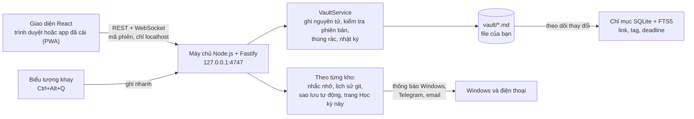

<div align="center">


# Second Brain

**Bộ não thứ hai cho sinh viên: ghi chú Markdown, deadline, lịch và bản đồ kiến thức. Tất cả chạy trên máy của bạn.**

**Tiếng Việt** | [English](README.en.md)


</div>

## Vì sao có Second Brain

Notion chậm và cần mạng. Obsidian mạnh nhưng phải cài plugin và cấu hình mới có deadline, lịch hay AI. Second Brain dùng được ngay từ lần mở đầu tiên: bạn thấy liền hôm nay cần làm gì, viết không vướng víu, và mọi ghi chú vẫn là file Markdown thường nằm trong thư mục của bạn.

- **Không bao giờ quên deadline.** Deadline có sẵn ở trang mở đầu, và máy chủ nhắc bạn bằng thông báo Windows kể cả khi cửa sổ app đang đóng, và cả qua Telegram hoặc email nếu bạn bật.
- **Ghi nhanh, dọn sau.** Mọi việc thường ngày chỉ cần một đến hai thao tác. `Ctrl+Alt+Q` ghi nhanh được cả khi bạn đang ở ứng dụng khác.
- **Kiến thức nối với nhau.** Liên kết hai chiều, tài liệu gắn vào ghi chú, và một bản đồ não cho thấy toàn cảnh.
- **Dữ liệu là của bạn.** Mọi thứ là file `.md` trong một thư mục. Gỡ app đi thì ghi chú vẫn dùng được. App không bao giờ âm thầm sửa những gì bạn đã viết.

## Tính năng

| | |
|---|---|
| **Hai phong cách** | **Bento mềm** (mặc định): trang Hôm nay là một lưới ô bo tròn màu pastel, mỗi ô lo một việc (lời chào, ngày, deadline gần nhất với số ngày còn lại, dải 14 ngày, việc hôm nay, vòng tiến độ đồ án, "Não hôm nay", ghi nhanh, 7 ngày ghi chép), cùng một thanh điều hướng gọn bên trái và ngăn "Thư mục". **Yên tĩnh**: giao diện cũ, gọn và tĩnh. Đổi trong **Cài đặt → Giao diện → Phong cách**, có hiệu lực ngay. |
| **Viết** | Editor hiện đẹp ngay khi gõ, kiểu Notion nhưng không có khối kéo thả. Gõ `## `, `**`, `- [ ]`, `[[` là thành định dạng. Có menu `/`, thanh định dạng với phím tắt kiểu Word (`Ctrl+B/I/U`) và chế độ xem Markdown thô (`Alt+S`). Phần bạn không sửa được ghi lại nguyên từng byte, kể cả công thức toán, HTML và chú thích. |
| **Liên kết** | `[[Wikilink]]` gợi ý không cần dấu (`giai tich` → *Giải tích 1*). Có backlinks, "nhắc đến chưa liên kết", tag lồng nhau (`#môn/giải-tích`) và thuộc tính đầu ghi chú. Đổi tên hay chuyển ghi chú thì mọi liên kết tự cập nhật, và có hoàn tác. |
| **Deadline và việc cần làm** | Trang **Hôm nay** có dải 14 ngày tô màu theo độ gấp, danh sách việc hôm nay và đồ án đang làm kèm % hoàn thành. Có trang **Việc cần làm**, **Lịch** tháng kéo thả để dời ngày, và hoàn tác trong 10 giây. |
| **Nhắc nhở** | Nhắc trước 3 ngày, 1 ngày và đúng ngày, vào giờ bạn chọn. Thông báo Windows hiện ngay cả khi cửa sổ app đóng. Máy ngủ qua giờ nhắc thì nhắc bù một lần, không bao giờ nhắc trùng. Bật thêm **Telegram** hoặc **email** (ví dụ Gmail) để nhận nhắc trên điện thoại; mỗi nhắc nhở chỉ gửi một lần, việc đã xong hay đã dời ngày thì không gửi nữa. |
| **Tài liệu** | Kéo thả hoặc dán PDF, ảnh, slide vào ghi chú, tên file luôn là duy nhất. Ảnh hiện ngay trong ghi chú. PDF mở trong app, có lật trang, phóng to và chọn chữ. Trang **Tài liệu** cho biết ghi chú nào đang nhắc đến từng file. |
| **Bản đồ não** | Mỗi ghi chú là một chấm sáng, màu theo thư mục. Bấm vào một chấm là tia sáng chạy sang các ghi chú kề, có ngăn tìm để dùng hoàn toàn bằng bàn phím. Mỗi ghi chú có bản đồ cục bộ riêng. **Tua thời gian** để xem bộ não lớn lên từng tuần (nút "Phát"), **lọc** theo thư mục, tag và thời gian (phần còn lại mờ đi), và ghi chú vừa sửa trong 24 giờ nhấp nháy nhẹ. Ô "Não hôm nay" trên trang Hôm nay cho thấy những gì bạn viết và nối hôm nay. |
| **Học kỳ và tổng kết tuần** | Bật **Trang Học kỳ này** (trong Cài đặt) để có một trang tự cập nhật liệt kê các môn học và đồ án theo môn, kèm hạn, số ngày còn lại và tiến độ. App không bao giờ ghi đè chỗ bạn tự sửa. Mỗi **Chủ nhật**, trang Hôm nay có **Tổng kết tuần**: Inbox còn bao nhiêu (có nút "Dọn Inbox"), tuần này bạn viết gì, xong việc gì, tuần tới có deadline nào. |
| **Tìm và ghi nhanh** | `Ctrl+K` tìm toàn bộ ghi chú không cần dấu (kể cả *đ*), lọc theo `tag:`, `folder:`, `due:7d`, và gõ `>` để chạy lệnh. `Alt+Q` ghi nhanh vào Inbox, `Alt+T` mở ghi chú hằng ngày. `Ctrl+Alt+Q` mở một ô ghi nhanh nhỏ từ bất kỳ ứng dụng nào. |
| **AI (M6)** | **Hỏi AI** về ghi chú của mình: câu hỏi về deadline lấy đúng danh sách của trang Hôm nay, câu hỏi khác trả lời từ vài đoạn ghi chú liên quan kèm link về ghi chú gốc. Bôi đen một đoạn rồi `Alt+A` để tóm tắt, viết lại, giải thích, gợi ý link hay tag. AI gợi ý chỗ để cho ghi chú trong Inbox. Tìm theo nghĩa. Tìm được cả chữ trong PDF. Dùng khóa API của bạn (Anthropic, OpenAI hoặc Gemini); không gửi gì đi trước khi bạn đồng ý, có hạn mức token mỗi tháng. **Nối Claude Desktop qua MCP** để Claude nạp paper thành wiki nghiên cứu, với quyền do app kiểm soát; bản đồ não sáng lên những trang AI vừa cập nhật. |
| **An toàn dữ liệu** | Ghi nguyên tử. Mỗi lần ghi đều kiểm tra phiên bản, nên khi file vừa bị sửa ở nơi khác app hiện màn hình xung đột ba bản (gốc, trên đĩa, của bạn). Có thùng rác, nhật ký thao tác khôi phục sau sự cố, và bản nháp giữ chữ khi tab bị tắt đột ngột. **Lịch sử phiên bản** dùng git, **sao lưu** ra file zip. **Sao lưu tự động** mỗi ngày (mặc định 21:00, vào thư mục bạn chọn, kể cả USB); máy tắt đúng giờ đó thì app sao lưu bù khi mở lại; chỉ xóa bản cũ do chính app tạo. Có thể đẩy lịch sử lên một kho GitHub riêng tư. |
| **Giao diện** | Mặc định tối ("Đêm tím"), có chế độ sáng, ba bộ màu (Dâu tằm, Hoa đào, Oải hương), ba cỡ chữ, tiếng Việt và tiếng Anh, tất cả đổi tức thì. Cài được thành app có cửa sổ và icon riêng, mở được cả khi mất mạng. Cửa sổ hẹp cỡ điện thoại vẫn dùng tốt: thanh tab ở dưới, các ngăn trượt lên từ dưới. |
| **Bản .exe** | Một tệp `Second Brain.exe` để bấm đúp là mở, không cần cài Node.js để chạy. Có **biểu tượng ở khay hệ thống** (mở app, ghi nhanh, thoát), phím `Ctrl+Alt+Q`, lối tắt trên Desktop và menu Start, và chạy được khi đăng nhập Windows. |

<table>
  <tr>
    <td></td>
    <td></td>
  </tr>
  <tr>
    <td></td>
    <td></td>
  </tr>
  <tr>
    <td></td>
    <td></td>
  </tr>
</table>

## Cài đặt

### Cần có

| | |
|---|---|
| Hệ điều hành | Windows 10 hoặc 11 |
| [Node.js 24 LTS](https://nodejs.org) | Cài một lần. App cần bản 22.12 trở lên. Bản `.exe` chạy không cần Node.js, nhưng cần Node.js để tạo ra nó. |
| Chrome hoặc Edge | Để dùng và cài app (PWA). |
| [Git for Windows](https://git-scm.com/download/win) | Không bắt buộc, cần cho lịch sử phiên bản. Không có Git thì app vẫn chạy bình thường. |

### Ba bước

1. **Tải mã nguồn** vào một thư mục tên `app`:
   ```powershell
   git clone https://github.com/khangnk144/SECONDBRAIN.git D:\SECONDBRAIN\app
   ```
   Thư mục cha (ở đây là `D:\SECONDBRAIN`) sẽ chứa ghi chú (`vault\`) và cấu hình (`.secondbrain\`).
2. **Mở app:** bấm đúp `D:\SECONDBRAIN\app\launcher\Mở Second Brain.cmd`. Lần đầu nó tự cài thư viện và build, mất vài phút. Sau đó app mở ở `http://localhost:4747`.
   Muốn có lối tắt ở thư mục gốc thì chép `app\launcher\root-wrapper.cmd` ra `D:\SECONDBRAIN` và đổi tên thành `Mở Second Brain.cmd`.
3. **Cài thành app** (tùy chọn): mở **Cài đặt → Ứng dụng → Cài đặt app**. Bật **Chạy khi đăng nhập Windows** để app có sẵn mỗi lần mở máy.

Lần đầu mở, app hỏi có muốn tạo **dữ liệu mẫu** để xem thử không. Dữ liệu mẫu xóa được bất cứ lúc nào trong Cài đặt.

### Mở bằng một tệp .exe (tùy chọn)

1. Bấm đúp `D:\SECONDBRAIN\app\launcher\Tạo bản exe.cmd`. Chờ vài phút tới khi cửa sổ báo `Xong: "D:\SECONDBRAIN\Second Brain.exe"`.
2. Bấm đúp `D:\SECONDBRAIN\Second Brain.exe`. Tệp chưa được ký số, nên lần đầu Windows có thể báo "Windows đã bảo vệ PC của bạn": bấm **Thông tin bổ sung** rồi **Vẫn chạy**.
3. App mở trong trình duyệt như mọi khi, với cùng ghi chú và cài đặt. Lần đầu, app tự tạo lối tắt "Second Brain" trên Desktop và trong menu Start, và hiện một biểu tượng ở khay hệ thống (góc phải thanh tác vụ).

Bản exe vẫn dùng thư mục `D:\SECONDBRAIN` như launcher, nên mỗi lần chỉ mở bằng một cách. Cập nhật mã nguồn hoặc Node.js xong thì bấm đúp `Tạo bản exe.cmd` lần nữa.

### Dừng và cập nhật

- Dừng app: **Cài đặt → Thoát Second Brain**, bấm chuột phải biểu tượng khay → **Thoát Second Brain**, hoặc chạy `"Mở Second Brain.cmd" stop` (bản exe: `"Second Brain.exe" --stop`).
- Cập nhật: chạy `git pull` trong thư mục `app` rồi mở lại. Launcher tự cài thêm và build lại khi cần. Nếu bạn dùng bản exe, tạo lại exe sau khi cập nhật.

## Phím tắt

| Phím | Việc | Phím | Việc |
|---|---|---|---|
| `Ctrl+K` | Tìm ghi chú và lệnh (`>`) | `Alt+G` | Bản đồ não |
| `Alt+N` | Ghi chú mới (chọn mẫu) | `Alt+S` | Chế độ Markdown thô |
| `Alt+Q` | Ghi nhanh vào Inbox | `Alt+1` / `Alt+2` | Ẩn hoặc hiện ngăn trái, ngăn phải |
| `Alt+T` | Ghi chú hằng ngày hôm nay | `Alt+W`, `Alt+[`, `Alt+]` | Đóng thẻ, thẻ trước, thẻ sau |
| `Alt+,` | Cài đặt | `Ctrl+/` | Bảng tất cả phím tắt |
| `Ctrl+Alt+Q` | Ghi nhanh từ bất kỳ ứng dụng nào (khi biểu tượng khay đang bật) | | |

Ở Bento mềm, `Alt+1` ẩn hoặc hiện ngăn "Thư mục". Mọi thao tác đều có nút hoặc menu tương đương, và mọi màn hình đều dùng được hoàn toàn bằng bàn phím.

## Dữ liệu của bạn nằm ở đâu

```
D:\SECONDBRAIN\
├── vault\                 Ghi chú của bạn: file Markdown thường
│   ├── 0 Inbox\           ghi nhanh, chưa phân loại
│   ├── 1 Projects\        đồ án, dự án nghiên cứu (có deadline)
│   ├── 2 Areas\           môn học, lĩnh vực lâu dài
│   ├── 3 Resources\       tài liệu gốc: papers\, slides\, web\, other\
│   ├── 4 Archive\         đã xong (không tính vào việc cần làm)
│   ├── Daily\  Templates\  Attachments\  wiki\
│   └── .secondbrain\      trạng thái của app cho kho này (chỉ mục, nhắc nhở, thùng rác, nhật ký)
├── Backups\               bản sao lưu tự động (nếu bạn bật và để thư mục mặc định)
├── .secondbrain\          cấu hình máy: settings.json (không chia sẻ file này)
├── Second Brain.exe       bản exe (nếu bạn đã tạo)
└── app\                   mã nguồn (repo này)
```

- Ghi chú dùng cú pháp quen thuộc: `[[liên kết]]`, `#tag`, front matter YAML, việc `- [ ] … 📅 2026-11-05` (tương thích plugin Tasks của Obsidian). Mở bằng Obsidian, VS Code hay Notepad đều được.
- App chỉ đọc và ghi trong `vault\`. Xóa nghĩa là chuyển vào thùng rác (`.secondbrain\trash`, giữ 30 ngày). Thao tác nhiều file được ghi nhật ký để hoàn tất hoặc hoàn tác sau sự cố.
- **Riêng tư:** máy chủ chỉ nghe ở `127.0.0.1`, mỗi yêu cầu phải có mã phiên và đúng nguồn gốc. Không có dữ liệu nào rời khỏi máy, trừ khi bạn tự bật AI, nhắc qua Telegram hay email, hoặc đẩy lên GitHub; mỗi thứ nói rõ gửi gì và gửi đến đâu trước khi bật. Mã bot, mật khẩu email và khóa GitHub chỉ nằm trong `settings.json`, app chỉ hiện bốn ký tự cuối và không bao giờ ghi chúng vào nhật ký hay bản sao lưu.

## Kiến trúc



| Phần | Công nghệ |
|---|---|
| Máy chủ | Node.js 24, TypeScript, Fastify, better-sqlite3 (FTS5), chokidar |
| Giao diện | React 18, Vite, Tiptap/ProseMirror, zustand, d3-force (canvas), pdf.js, i18next |
| Markdown | unified/remark với bộ chuyển đổi giữ nguyên từng khối chưa sửa |
| Chất lượng | Vitest, Testing Library, Playwright, ESLint (có luật cấm chữ giao diện viết cứng và màu viết cứng), kiểm tra tương phản màu |

## Phát triển

```bash
npm install
npm run dev          # http://localhost:4747, tự tải lại khi sửa code
npm test             # test unit và tích hợp (server, web, công cụ)
npm run test:e2e     # build rồi chạy Playwright trên một kho tạm
npm run lint         # ESLint, màu viết cứng, khớp bản dịch VI/EN, tương phản
npm run typecheck
npm run gen-vault -- --out <thư mục trống>   # kho 5.000 ghi chú để đo hiệu năng
npm run build:exe    # tạo dist-exe/Second Brain.exe (một tệp chạy được, không cần Node.js)
```

| Thư mục | Nội dung |
|---|---|
| `server/` | API REST và WebSocket, kho ghi chú, chỉ mục, nhắc nhở (cả Telegram và email), lịch sử git, sao lưu tự động, trang Học kỳ này, tổng kết tuần, chế độ exe và biểu tượng khay |
| `web/` | giao diện: editor, các màn hình, hai phong cách Bento mềm và Yên tĩnh, PWA |
| `launcher/` | launcher Windows (`start`, `stop`, `login`), `Tạo bản exe.cmd`, script biểu tượng khay |
| `scripts/`, `eslint-rules/` | công cụ kiểm tra chất lượng |
| `docs/` | kiến trúc, chuẩn code, hướng dẫn chạy, nhật ký thay đổi |
| `DECISIONS.md`, `MILESTONE-*.md` | quyết định thiết kế và báo cáo nghiệm thu từng mốc |

Mỗi mốc chỉ được tính là xong khi mọi tiêu chí nghiệm thu đều có test, hoặc có bước kiểm tra tay ghi trong `MILESTONE-<n>.md`. Mỗi mốc còn được hai người soát độc lập: một về an toàn dữ liệu, một về giao diện. Hiện app có gần 5.000 test tự động và hơn 100 kịch bản chạy trên trình duyệt thật.

## Lộ trình

| Mốc | Nội dung | Trạng thái |
|---|---|---|
| M0 đến M3 | Khung app, kho ghi chú và chỉ mục, editor và liên kết, Hôm nay, lịch, tìm kiếm, bản đồ não | ✅ |
| M4 | Nhắc nhở Windows, Cài đặt, tài liệu và trình xem PDF, lịch sử phiên bản, sao lưu, cài app (PWA) | ✅ bản 1.0 |
| M6 | AI: chat với ghi chú của mình kèm trích dẫn, tìm theo nghĩa, gợi ý liên kết và tag, dọn Inbox giúp (AI đề xuất, bạn đồng ý mới đổi); nối Claude qua MCP để nạp paper thành wiki nghiên cứu; đọc chữ trong PDF | ✅ |
| M5 | Phong cách Bento mềm (mặc định mới); bản đồ não tua thời gian và bộ lọc, "Não hôm nay"; trang Học kỳ này; tổng kết tuần; sao lưu tự động và đẩy lên GitHub; giao diện cửa sổ hẹp; bản `.exe` không cần Node.js, biểu tượng khay và `Ctrl+Alt+Q`; nhắc qua Telegram và email | ✅ (chờ bạn kiểm tra trên Windows) |

## Gặp sự cố

| Hiện tượng | Cách xử lý |
|---|---|
| "Chưa tìm thấy Node.js" | Cài Node.js 24 LTS rồi mở lại launcher. |
| Báo cổng 4747 đang bị dùng | Hộp thoại ghi tên chương trình đang chiếm cổng. Đóng chương trình đó, hoặc đổi cổng trong Cài đặt rồi cài lại app. |
| App đã cài báo "Chưa kết nối với máy chủ" | Bấm đúp launcher. App tự kết nối lại, không cần tải lại trang. |
| Lịch sử phiên bản báo cần Git | Cài Git for Windows. Các tính năng khác không bị ảnh hưởng. |
| Mở `Second Brain.exe` thì Windows báo "Windows đã bảo vệ PC của bạn" | Bấm **Thông tin bổ sung** rồi **Vẫn chạy**. Tệp chưa được ký số nên Windows cảnh báo. |
| `Ctrl+Alt+Q` không mở ô ghi nhanh | Xem **Cài đặt → Ứng dụng**: nếu phím đang bị ứng dụng khác dùng, app sẽ nói, và bạn vẫn ghi nhanh được bằng chuột phải biểu tượng khay → **Ghi nhanh**. Không thấy biểu tượng khay thì tắt rồi bật lại công tắc "Biểu tượng khay và phím tắt toàn hệ thống". |
| Sao lưu tự động báo "Lỗi: không tìm thấy thư mục sao lưu" | Thường là USB chưa cắm. Cắm lại, app tự thử lại mỗi giờ; hoặc chọn thư mục khác. |

Nhật ký (không chứa nội dung ghi chú) mở được ở **Cài đặt → Mở thư mục log**. Chi tiết thêm ở [`docs/deployment-guide.md`](docs/deployment-guide.md).

## Giấy phép

Bản quyền © 2026 khangnie. Mã nguồn chưa được phát hành theo giấy phép mã nguồn mở, mọi quyền được bảo lưu.

App dùng các thư viện mã nguồn mở, mỗi thư viện theo giấy phép riêng của nó. Trong đó có phông [Be Vietnam Pro](https://github.com/bettergui/BeVietnamPro) và [JetBrains Mono](https://github.com/JetBrains/JetBrainsMono) (SIL OFL 1.1), [Phosphor Icons](https://phosphoricons.com) (MIT), [pdf.js](https://github.com/mozilla/pdf.js) (Apache 2.0), [Tiptap](https://tiptap.dev) (MIT), [Fastify](https://fastify.dev) (MIT) và [SQLite](https://sqlite.org) (public domain).
